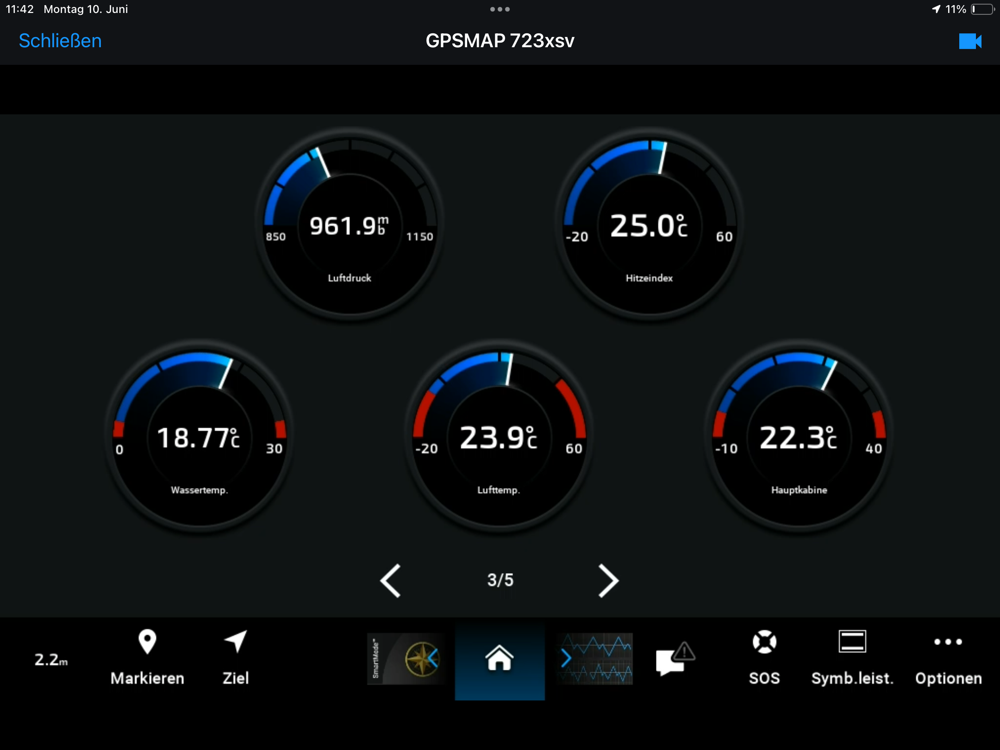
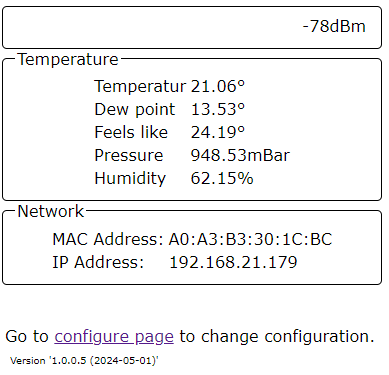
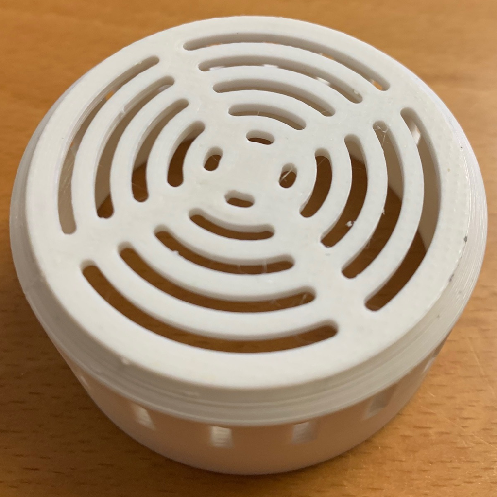

# NMEA2000-BME280 Environmental Sensor

## Table of contents
- [NMEA2000-BME280 Environmental Sensor](#nmea2000-bme280-environmental-sensor)
  - [Table of contents](#table-of-contents)
  - [Description](#description)
  - [Features](#features)
  - [Related projects](#related-projects)
  - [Hardware](#hardware)
  - [NMEA 2000](#nmea-2000)
  - [Libraries](#libraries)
  - [Configuration](#configuration)
    - [System Configuration](#system-configuration)
      - [Thing name](#thing-name)
      - [AP password](#ap-password)
      - [WiFi SSID](#wifi-ssid)
      - [WiFi password](#wifi-password)
      - [AP offline mode after (minutes)](#ap-offline-mode-after-minutes)
    - [NMEA 2000 Settings](#nmea-2000-settings)
      - [Instance](#instance)
      - [SID](#sid)
    - [Temperature source](#temperature-source)
    - [Humidity source](#humidity-source)
  - [Default Password](#default-password)
  - [Default IP address](#default-ip-address)
  - [Firmware Update](#firmware-update)
  - [Blinking codes](#blinking-codes)
  - [Reset](#reset)

## Description
This device measures temperature, humidity, and air pressure. The dew point and perceived temperature are also calculated. The sensor used is a BME280. The values are transmitted as NMEA 2000 messages over the NMEA bus. Device configuration is done through a web interface, and real-time values can also be viewed on a web page in addition to the NMEA bus. The configuration page also provides a firmware update entry.

## Features
- Temperature range from -40°C to +85°C with a high degree of accuracy
- Relative humidity in the range of 0% to 100%
- Barometric pressure in the range of 300 hPa to 1100 hPa, with an absolute accuracy of approximately ±1 hPa
- Calculated dew point and perceived temperature
- NMEA 2000 compliant messaging
- Web-based configuration interface
- Real-time monitoring via web interface
- WiFi connectivity with access point fallback
- Over-the-air firmware updates
- Visual status indication via LED

## Related projects
This sensor is based on the [NMEA2000-SensorBoard](https://github.com/minou65/NMEA2000-SensorBoard). Other sensors built on the same board:

- [NMEA2000-DS1820](https://github.com/minou65/NMEA2000-DS1820) - Temperature sensor for up to 4 DS1820 sensors
- [NMEA2000-FluidLevel](https://github.com/minou65/NMEA2000-FluidLevel) - Fluid level sensor
- [NMEA2000-BatteryMonitor](https://github.com/minou65/NMEA2000-BatteryMonitor) - Battery monitor
- [NMEA2000-SmokeSensor](https://github.com/minou65/NMEA2000-SmokeSensor) - Smoke sensor
- [NMEA2000-Relaybox](https://github.com/minou65/NMEA2000-Relaybox) - Relay box

## Hardware
The hardware is based on the [NMEA2000-SensorBoard](https://github.com/minou65/NMEA2000-SensorBoard), fitted with a BME280 sensor.

| Pin | Wire color | Signal |
| --- | --- | --- |
| 1 | white | SCL |
| 2 | brown | SDA |
| 3 | yellow | GND |
| 4 | green | 3.3V |

In the [stl](stl) directory are two STL files. These can be used to print an appropriate housing on a 3D printer.

## NMEA 2000
Depending on the temperature source, one of the following PGNs are sent:

- 130310, Environmental Parameters (deprecated)
- 130312, Temperature (deprecated)
- 130316, Temperature, Extended Range

For humidity the following PGN is sent:
- 130313, Humidity

and for pressure:
- 130314, Pressure

## Libraries
The software has been created using Visual Studio with the Visual Micro add-on. To build it, you also need these libraries:

- [Adafruit BME280 Library](https://github.com/adafruit/Adafruit_BME280_Library)
- [Adafruit Unified Sensor](https://github.com/adafruit/Adafruit_Sensor)
- [NMEA2000](https://github.com/ttlappalainen/NMEA2000)
- [NMEA2000_esp32](https://github.com/ttlappalainen/NMEA2000_esp32)
- [AsyncTCP (3.2.6)](https://github.com/mathieucarbou/AsyncTCP)
- [ESPAsyncWebServer (3.3.12)](https://github.com/mathieucarbou/ESPAsyncWebServer)
- [WebSerial (2.0.7)](https://github.com/ayushsharma82/WebSerial)
- [IotWebConf](https://github.com/minou65/IotWebConf)
- [IotWebConfAsync (1.0.2)](https://github.com/minou65/IotWebConfAsync)
- [IotWebRoot](https://github.com/minou65/IotWebRoot)

## Configuration
After the first boot, there are some values that need to be set up. These items are marked with * (star) in the list below.

### System Configuration

#### Thing name
Please change the name of the device to a name that describes it well. It is advised to include a location if you plan to set up multiple devices in the same area. Use only English letters and underscore (`_`), for example `main_cabin`. *

#### AP password
This password is used when you want to access the device later on. Provide a password with at least 8 and at most 32 characters. A password with at least 12 characters and multiple character classes is recommended. *

#### WiFi SSID
The name of the WiFi network you want the device to connect to. *

#### WiFi password
The password of the WiFi network above. *

#### AP offline mode after (minutes)
If you do not plan to connect the sensor to a WiFi network, you do not need to configure WiFi SSID and WiFi password. You can also disable AP mode after a certain time. Valid values are from 0 to 30 minutes. A value of 0 means WiFi stays enabled.

### NMEA 2000 Settings

#### Instance
This should be unique at least on one device. May be best to have it unique across all devices sending these PGNs. A total of 5 instances are occupied by the device, starting with the number set here. *

#### SID
Sequence identifier. In most cases you can use a fixed value, e.g. 255. The sequence identifier field is used to tie different PGN data together to the same sampling or calculation time.

### Temperature source
One of the following temperature sources can be selected:
- Sea water temperature
- Outside temperature
- Inside temperature
- Engine room temperature
- Main cabin temperature
- Live well temperature
- Bait well temperature
- Refrigeration temperature
- Heating system temperature
- Freezer temperature
- Exhaust gas temperature
- Shaft seal temperature

### Humidity source
Can be one of the following locations:
- inside
- outside
- unknown

## Default Password
Username is `admin`. When not connected to an AP, the default password is `123456789`.

## Default IP address
When in AP mode, the default IP address is `192.168.4.1`.

## Firmware Update
To update the firmware, navigate to the configuration page and click on the firmware update link. Follow the on-screen instructions to complete the update process.

## Blinking codes
The table below summarizes the meaning of the blink codes.

| Blinking Pattern | Meaning |
| --- | --- |
| Rapid blinking (mostly on, interrupted by short off periods) | Access Point mode active. The device creates its own WiFi network. |
| Alternating on/off blinking | Trying to connect to the configured WiFi network. |
| Mostly off with occasional short flash | The device is online. |
| Mostly off with occasional long flash | The device is in offline mode. |

## Reset
When `CONFIG_PIN` is pulled to ground on startup, the Thing uses the initial password to build an AP (for example in case of a lost password).

Reset pin is GPIO 13.